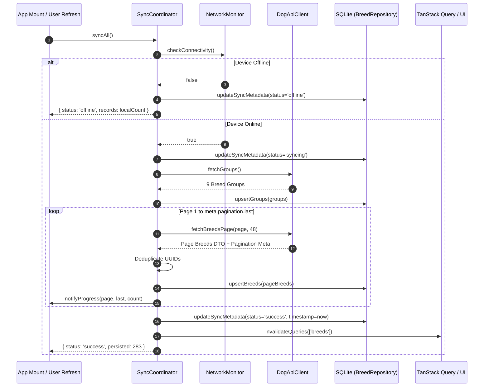
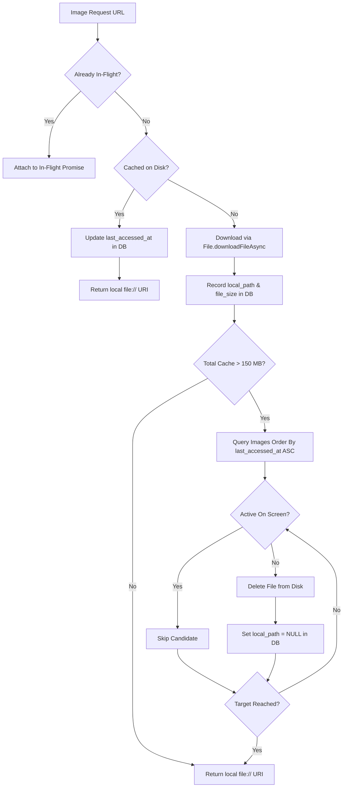

# Tripare Dog Breed Explorer — Architecture Specification

## 1. Executive Architectural Overview

The **Tripare Dog Breed Explorer** is built as an enterprise-grade, offline-first React Native / Expo application targeting both iOS and Android. The architecture is engineered around the principle that **the local SQLite database is the single durable source of truth**, while the remote Dog API v2 serves as an upstream data provider.

The architecture cleanly decouples five discrete tiers:

1. **Network & Ingest Tier:** Resilient HTTP transport with exponential backoff, full jitter, timeout cancellation, and runtime Zod validation.
2. **Synchronization Tier:** Multi-page dynamic pagination coordinator managing non-destructive sync, deduplication across pages, and auto-reconnection recovery.
3. **Persistence Tier:** Versioned Expo SQLite database operating in Write-Ahead Logging (WAL) mode with foreign-key constraints and indexes designed for composite filtering.
4. **State & Reactive Tier:** TanStack Query for request lifecycle/invalidation combined with Zustand for user-driven UI filter parameters and theme preferences.
5. **Presentation & Virtualization Tier:** React 19 concurrent-ready component hierarchy leveraging memoized `SectionList` projections, custom badge scales, and an interactive image gallery.

```mermaid
graph TD
    subgraph Remote API
        DogAPI[Dog API v2 REST Endpoints]
    end

    subgraph Transport & Ingestion
        ApiClient[DogApiClient\nBackoff + Jitter + Zod Schemas]
        NetInfo[NetworkMonitor\nNetInfo Event Emitter]
    end

    subgraph Coordination Layer
        SyncCoord[SyncCoordinator\nDynamic Multi-Page Pagination\nConflict-Free Upsert]
        ImageMgr[ImageManager\n150 MB Budget LRU Eviction]
    end

    subgraph Storage Tier (Source of Truth)
        SQLite[(Expo SQLite Database\nWAL Mode + Foreign Keys\nbreeds, breed_groups, breed_images)]
        FileSystem[(Expo FileSystem Cache\n/cache/dog_images/)]
    end

    subgraph State Management
        TanStack[TanStack Query\nQuery Keys: breeds, breed-detail, groups]
        ZustandFilters[Zustand Filter Store\nSearch, Groups, Size, Coat, Traits]
        ZustandTheme[Zustand Theme Store\nDark/Light Mode]
    end

    subgraph UI & Virtualization Tier
        ExplorerScreen[BreedListScreen\nVirtualized SectionList]
        DetailScreen[BreedDetailsScreen\nOverview, Traits, Gallery]
        FilterModal[FilterScreen\nMulti-Select, Range Pickers]
    end

    DogAPI <-->|JSON over HTTPS| ApiClient
    NetInfo -->|Network Status Events| SyncCoord
    ApiClient --> SyncCoord
    SyncCoord -->|Atomic Batch Upserts| SQLite
    ImageMgr <-->|Metadata & Size Tracking| SQLite
    ImageMgr <-->|LRU Eviction / Download| FileSystem
    SQLite -->|Lightweight Projections| TanStack
    ZustandFilters -->|Filter Predicates| TanStack
    TanStack --> ExplorerScreen
    TanStack --> DetailScreen
    ZustandFilters <--> FilterModal
    ZustandTheme --> ExplorerScreen
    ZustandTheme --> DetailScreen
```

---

## 2. Data Flow & Synchronization Lifecycle

### 2.1 Dynamic Pagination & Deduplication

The Dog API v2 provides `GET /v2/breeds?page[size]=48`. Rather than hardcoding the page count or total record count:

1. `SyncCoordinator` initiates a fetch for `page[number]=1`.
2. The response header/body meta returns:
   ```json
   "meta": {
     "pagination": {
       "current": 1,
       "next": 2,
       "last": 6,
       "records": 283
     }
   }
   ```
3. `SyncCoordinator` dynamically parses `meta.pagination.last` (6 pages) and iterates sequentially or concurrently with bounded concurrency through all remaining pages.
4. Breeds can occasionally appear on overlapping boundaries during concurrent inserts on the server. `SyncCoordinator` deduplicates breeds by UUID (`b.id`) across in-flight pages prior to triggering SQLite bulk transactions.



### 2.2 Non-Destructive Partial Sync Recovery

A common fault in mobile synchronization is network disconnection midway through a multi-page pull:

- **Resilience Policy:** Pages already persisted in SQLite are **never rolled back or deleted** when subsequent pages fail.
- **Timestamp Integrity:** The `last_successful_at` timestamp in `sync_metadata` is **only** stamped when every page in the catalog has successfully landed.
- If page 4 of 6 fails due to a dropped socket, `sync_status` transitions to `'error'`, records from pages 1–3 remain completely queryable and visible in the UI, and the user is alerted via a non-blocking toast/banner.
- On auto-reconnect (`networkMonitor.subscribe`), the coordinator checks if `last_successful_at` is missing or older than 1 hour, immediately scheduling a non-destructive background sync.

---

## 3. Storage Architecture & SQLite Schema

SQLite is configured via `expo-sqlite` using modern async prepared queries and transactional closures.

### 3.1 Pragma Configurations

Upon database opening, the following pragmas are executed:

- `PRAGMA journal_mode = WAL;` (Write-Ahead Logging permits concurrent reads while writes are being written).
- `PRAGMA foreign_keys = ON;` (Enforces referential integrity between breed images and breeds).
- `PRAGMA synchronous = NORMAL;` (Maximizes mobile flash endurance without sacrificing crash-consistency).

### 3.2 Schema Definition

```sql
-- 1. Groups table
CREATE TABLE IF NOT EXISTS breed_groups (
  id TEXT PRIMARY KEY NOT NULL,
  name TEXT NOT NULL,
  updated_at INTEGER NOT NULL
);

-- 2. Core breeds table
CREATE TABLE IF NOT EXISTS breeds (
  id TEXT PRIMARY KEY NOT NULL,
  name TEXT NOT NULL,
  normalized_name TEXT NOT NULL,
  description TEXT,
  hypoallergenic INTEGER NOT NULL DEFAULT 0,
  group_id TEXT,
  life_min REAL,
  life_max REAL,
  male_weight_min REAL,
  male_weight_max REAL,
  female_weight_min REAL,
  female_weight_max REAL,
  male_height_min REAL,
  male_height_max REAL,
  female_height_min REAL,
  female_height_max REAL,
  origin_era TEXT,
  origin_region TEXT,
  origin_country TEXT,
  coat_type TEXT,
  coat_length TEXT,
  traits_json TEXT,
  temperament_json TEXT,
  other_names_json TEXT,
  recognized_by_json TEXT,
  size_band TEXT NOT NULL,
  updated_at INTEGER NOT NULL,
  FOREIGN KEY (group_id) REFERENCES breed_groups(id) ON DELETE SET NULL
);

-- 3. Breed images & attribution table
CREATE TABLE IF NOT EXISTS breed_images (
  id TEXT PRIMARY KEY NOT NULL,
  breed_id TEXT NOT NULL,
  display_order INTEGER NOT NULL DEFAULT 0,
  url TEXT NOT NULL,
  thumb_url TEXT,
  medium_url TEXT,
  large_url TEXT,
  author TEXT,
  license TEXT,
  license_url TEXT,
  source TEXT,
  source_url TEXT,
  local_path TEXT,
  file_size INTEGER DEFAULT 0,
  last_accessed_at INTEGER DEFAULT 0,
  updated_at INTEGER NOT NULL,
  FOREIGN KEY (breed_id) REFERENCES breeds(id) ON DELETE CASCADE
);

-- 4. Synchronization metadata singleton
CREATE TABLE IF NOT EXISTS sync_metadata (
  id INTEGER PRIMARY KEY CHECK (id = 1),
  last_attempted_at INTEGER,
  last_successful_at INTEGER,
  sync_status TEXT NOT NULL DEFAULT 'idle',
  expected_records INTEGER DEFAULT 0,
  persisted_records INTEGER DEFAULT 0,
  error_message TEXT
);
```

### 3.3 Index Strategy for Sub-Millisecond Filtering

- `idx_breeds_group_id` on `breeds(group_id)` — Accelerated group joins.
- `idx_breeds_size_band` on `breeds(size_band)` — Instant size band filtering.
- `idx_breeds_hypoallergenic` on `breeds(hypoallergenic)` — Immediate hypoallergenic toggle filtering.
- `idx_breeds_coat` on `breeds(coat_type, coat_length)` — Dual coat matching.
- `idx_breeds_normalized_name` on `breeds(normalized_name)` — Lowercase prefix and substring search.
- `idx_breed_images_breed_id` on `breed_images(breed_id, display_order)` — Fast thumbnail and gallery lookup.
- `idx_breed_images_lru` on `breed_images(local_path, last_accessed_at)` — High-speed LRU eviction scanning.

---

## 4. Managed Image Cache & 150 MB Hard Budget LRU Engine

Mobile image caching without eviction quickly bloats application storage and triggers OS-level termination. The custom `ImageManager`:

1. **Configurable Budget:** Default 150 MB (`157,286,400 bytes`), configurable via `EXPO_PUBLIC_IMAGE_CACHE_MAX_MB`.
2. **Directory Isolation:** Files are written to `Directory(Paths.cache, 'dog_images')` with safe deterministic hashed filenames (`url.replace(/[^a-zA-Z0-9_-]/g, '_')`).
3. **Concurrency Coalescing:** Identical concurrent requests for the same URL share a single in-flight `Promise`, preventing duplicate network roundtrips.
4. **Active Screen Image Protection:** Components call `imageManager.registerActiveImage(imageId)` on mount and `unregisterActiveImage(imageId)` on unmount.
5. **LRU Eviction Algorithm:**
   - On every successful image download, total disk consumption is queried via `SELECT SUM(file_size) FROM breed_images WHERE local_path IS NOT NULL`.
   - If total consumption exceeds the budget, candidates are fetched in ascending access order:
     `SELECT id, local_path, file_size FROM breed_images WHERE local_path IS NOT NULL ORDER BY last_accessed_at ASC`.
   - The eviction loop verifies candidate IDs against `activeDisplayedImages`. If an image is currently visible on the screen, **it is preserved**.
   - Evicted files are physically deleted via `new File(local_path).delete()` and the database record is updated to `local_path = NULL`.



---

## 5. UI Architecture & Virtualization

### 5.1 SectionList Lightweight Projection Model

Loading all 283 breeds with deep JSON trait trees into React Native memory causes heap spikes and frame drops during fast scrolls.

- `breedRepository.getBreedListProjections(filters)` returns **only** lightweight presentation fields:
  ```ts
  interface BreedListItem {
    id: string;
    name: string;
    group_name: string;
    thumb_url: string | null;
    hypoallergenic: boolean;
    size_band: SizeBand;
    coat_type: string | null;
    coat_length: string | null;
    life_span_formatted: string;
    weight_formatted: string;
  }
  ```
- Items are grouped into a `SectionList<BreedListItem>` grouped by `group_name` with sticky or standard section headers.
- Each item component is wrapped in `React.memo` with a custom comparison function checking `id`, `name`, `group_name`, and `thumb_url`.
- Windowing parameters are tuned for mobile hardware:
  ```ts
  windowSize={7}
  maxToRenderPerBatch={10}
  initialNumToRender={12}
  removeClippedSubviews={Platform.OS === 'android'}
  ```

### 5.2 Filter Screen & Zustand Reactive Store

Filter state is stored in Zustand with shallow equality selectors:

- `searchQuery` (debounced at 300ms, matching both primary `name` and secondary `other_names`).
- `selectedGroupIds: string[]`
- `selectedSizeBands: SizeBand[]`
- `selectedCoatLengths: CoatLength[]` (maps `'wire'` coats to normalized wire length).
- `hypoallergenicOnly: boolean`
- `traitThresholds: Record<TraitKey, number>` (minimum threshold from 1 to 5 for traits like `good_with_children`, `energy_level`, `trainability`, etc.).

---

## 6. Security, Offline Resilience & Error Boundaries

- **Root Error Boundary:** Catches unhandled JavaScript render exceptions and displays a user-friendly recovery view with a "Retry Application" reset hook.
- **Offline Banner:** Dynamically surfaces connection status via `@react-native-community/netinfo` with smooth height transitions without blocking the breed catalog.
- **Zero Raw SQL String Interpolation:** All SQLite interactions use parameterized queries (`?`) to prevent SQL injection vulnerabilities.
- **Strict TypeScript (Zero `any`):** Every API payload, repository row, store action, and component prop is strictly typed and verified by `tsc --noEmit` and `eslint`.
