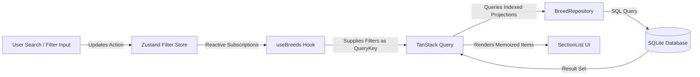
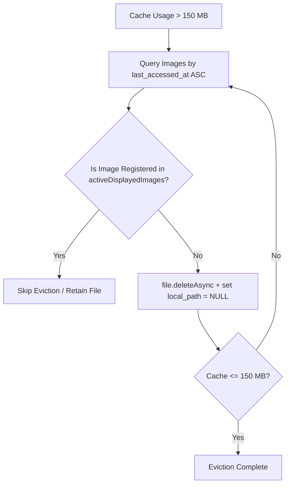

# Architecture Decision Records (ADRs)

This document formalizes the key architectural, technical, and domain decisions implemented in the **Tripare Dog Breed Explorer** application.

---

## Index of Decisions

- [ADR-001: SQLite as the Durable Single Source of Truth](#adr-001-sqlite-as-the-durable-single-source-of-truth)
- [ADR-002: State Architecture — TanStack Query Layered with Zustand](#adr-002-state-architecture--tanstack-query-layered-with-zustand)
- [ADR-003: Virtualized SectionList with Lightweight Query Projections](#adr-003-virtualized-sectionlist-with-lightweight-query-projections)
- [ADR-004: Size Band Categorization Strategy](#adr-004-size-band-categorization-strategy)
- [ADR-005: Coat Wire Mapping Normalization](#adr-005-coat-wire-mapping-normalization)
- [ADR-006: Managed 150 MB Image Cache with Active-Protected LRU Eviction](#adr-006-managed-150-mb-image-cache-with-active-protected-lru-eviction)
- [ADR-007: Dynamic Multi-Page Pagination with Non-Destructive Partial Sync](#adr-007-dynamic-multi-page-pagination-with-non-destructive-partial-sync)
- [ADR-008: Dual Snake_Case / CamelCase Trait Schema Ingestion](#adr-008-dual-snake_case--camelcase-trait-schema-ingestion)

---

## ADR-001: SQLite as the Durable Single Source of Truth

### Context

Mobile applications interacting with paginated REST APIs often suffer from memory volatility, cache loss upon app restarts, and slow filtered lookups when relying solely on in-memory caches or basic key-value stores (`AsyncStorage`, `MMKV`). The Dog API catalog consists of 283 dog breeds, 9 breed groups, and associated image attribution metadata that must be instantly searchable, groupable, and filterable offline.

### Decision

We use **Expo SQLite** (`expo-sqlite`) operating in **Write-Ahead Logging (WAL) mode** as the primary, durable single source of truth for all breed catalog data. Remote HTTP responses are treated strictly as upstream data ingest operations that write to SQLite before being surfaced to the UI.

### Consequences

- **Positive:**
  - Zero-latency instant startup from disk cache, even in airplane mode.
  - Advanced relational capabilities: `LEFT JOIN breed_groups`, composite `WHERE` clauses, SQL substring search (`LIKE`), and indexed ordering.
  - Write-Ahead Logging allows background sync writes without blocking foreground UI read queries.
  - Foreign key cascading ensures referential integrity when refreshing relationships.
- **Negative:**
  - Schema migrations require structured DDL version tracking.
  - Data transfer requires an asynchronous bridge between Hermes and native SQLite.

---

## ADR-002: State Architecture — TanStack Query Layered with Zustand

### Context

Modern React Native applications must balance server-cache lifecycle (stale time, refetch triggers, loading indicators) with user-driven client UI state (debounced search text, multi-select filter sets, slider values, theme selection). Conflating both in a single global store leads to unnecessary re-renders, race conditions, and excessive boilerplate.

### Decision

We establish a clean, orthogonal separation between two specialized state management libraries:

1. **TanStack Query (v5):** Controls query lifecycle, async state (`isFetching`, `isRefetching`), and cache invalidation keys (`['breeds', filters]`, `['breed', id]`, `['groups']`). Queries fetch directly from the local SQLite repository.
2. **Zustand (v5):** Stores transient, interactive UI parameters: `searchQuery`, `selectedGroupIds`, `selectedSizeBands`, `selectedCoatLengths`, `hypoallergenicOnly`, and `traitThresholds`, alongside `themeStore` for light/dark preference.



### Consequences

- **Positive:**
  - Filtering changes instantly update query keys without network requests.
  - Components subscribe to atomic slices via Zustand selectors, preventing full-screen re-renders during keyboard typing.
  - TanStack Query coordinates seamless pull-to-refresh and background refetching.

---

## ADR-003: Virtualized SectionList with Lightweight Query Projections

### Context

Each breed object contains rich metadata: descriptions, life expectancy, male/female weight/height ranges, era/country of origin, 11 trait metrics, temperament tags, and attribution metadata. Returning deep JSON representations for 283 items in list views consumes significant JavaScript heap memory and degrades scroll FPS.

### Decision

We partition queries into two distinct models:

1. **Lightweight Projections (`BreedListItem`):** The repository executes an optimized SQL query retrieving only what is necessary for list cells (`id`, `name`, `group_name`, `thumb_url`, `hypoallergenic`, `size_band`, `life_span_formatted`, `weight_formatted`).
2. **Deep Detail Queries (`BreedDetail`):** Full JSON trait structures and attribution galleries are queried only when the user navigates into a specific breed's detail screen.
3. We render the list using React Native's `SectionList`, grouped by `group_name`.

### Consequences

- **Positive:**
  - Minimal JS thread allocation per item; smooth 60 FPS scrolling.
  - Sticky group headers provide natural navigation across the 9 official Dog API groups.
- **Negative:**
  - Requires maintaining two repository query signatures (`getBreedListProjections` vs `getBreedById`).

---

## ADR-004: Size Band Categorization Strategy

### Context

The Dog API v2 provides male and female weight ranges in kilograms (`male_weight.min`, `male_weight.max`, `female_weight.min`, `female_weight.max`) but does not categorize breeds into human-friendly size bands. Users naturally search by size ("Toy", "Small", "Medium", "Large", "Giant").

### Decision

We compute and persist a deterministic `size_band` column upon ingesting each breed, based on the midpoint of available adult weights (averaging male and female maximums or midpoints):

- **Toy:** $< 5.0\text{ kg}$ ($< 11\text{ lbs}$)
- **Small:** $5.0\text{ kg} \le \text{weight} < 12.0\text{ kg}$ ($11 - 26\text{ lbs}$)
- **Medium:** $12.0\text{ kg} \le \text{weight} < 25.0\text{ kg}$ ($26 - 55\text{ lbs}$)
- **Large:** $25.0\text{ kg} \le \text{weight} < 45.0\text{ kg}$ ($55 - 99\text{ lbs}$)
- **Giant:** $\ge 45.0\text{ kg}$ ($\ge 99\text{ lbs}$)
- Breeds with unrecorded weight data fall back to `'medium'`.

### Consequences

- **Positive:**
  - Persisted in SQLite with a dedicated index (`idx_breeds_size_band`) for zero-cost filtering.
  - Reusable utility function `calculateSizeBand()` verified with comprehensive unit tests.

---

## ADR-005: Coat Wire Mapping Normalization

### Context

In the live Dog API v2, coat characteristics are exposed across two distinct fields:

- `coat.type` (e.g. `'wire'`, `'smooth'`, `'double'`, `'hairless'`)
- `coat.length` (e.g. `'short'`, `'medium'`, `'long'`)

For wire-coated breeds (such as the Wirehaired Pointing Griffon or Wire Fox Terrier), the API often classifies `coat.type` as `'wire'` while setting `coat.length` as `'short'`. If filters only inspect `coat.length`, wire-haired breeds are misclassified or excluded when users search for wire coats.

### Decision

We implement a dual-mapping normalizer in `coatNormalizer.ts`:

```ts
export function normalizeCoat(rawType?: string | null, rawLength?: string | null): NormalizedCoat {
  const isWire =
    rawType?.toLowerCase().includes('wire') || rawLength?.toLowerCase().includes('wire');
  if (isWire) {
    return { coatType: 'wire', coatLength: 'wire' };
  }
  return {
    coatType: rawType?.toLowerCase() || 'unknown',
    coatLength: rawLength?.toLowerCase() || 'unknown',
  };
}
```

When a user selects "Wire" in the filter chips or filter screen, the SQL query checks `coat_type = 'wire' OR coat_length = 'wire'`.

### Consequences

- **Positive:**
  - Robust against API semantic quirks.
  - Matches user expectations across both visual representation and filter queries.

---

## ADR-006: Managed 150 MB Image Cache with Active-Protected LRU Eviction

### Context

High-resolution dog breed photography can quickly saturate mobile device storage if unmanaged. Conversely, aggressive eviction can discard images currently being rendered on screen, causing visual flickering, layout thrashing, and unnecessary re-downloads.

### Decision

We implement an autonomous `ImageManager` leveraging modern class-based Expo 57 FileSystem APIs (`Paths`, `File`, `Directory`) with the following rules:

1. **Hard Limit:** Enforces a 150 MB ceiling (`157,286,400 bytes`), configurable via `EXPO_PUBLIC_IMAGE_CACHE_MAX_MB`.
2. **Access Tracking:** Each cache hit updates `last_accessed_at` in the SQLite `breed_images` table.
3. **Active Screen Image Protection:** Components register visible images into an in-memory `Set<string>`.
4. **LRU Eviction Priority:** If disk consumption exceeds 150 MB, the oldest unaccessed images are deleted from disk, **skipping any image registered as active on screen**.



### Consequences

- **Positive:**
  - Strict compliance with disk budgets without memory leaks.
  - Smooth user experience with zero on-screen image disappearing artifacts.

---

## ADR-007: Dynamic Multi-Page Pagination with Non-Destructive Partial Sync

### Context

The live Dog API distributes 283 dog breeds over 6 pages (`page[size]=48`). Mobile network conditions are volatile; connections can drop midway through page 3 or 4. Naive sync implementations either fail completely without persisting anything or prematurely set `last_successful_at`, permanently stranding missing pages.

### Decision

1. **Dynamic Page Discovery:** We never hardcode page count or total record counts. The coordinator reads `meta.pagination.last` from page 1 and pulls sequentially up to that limit.
2. **Non-Destructive Ingest:** Each page fetched is immediately persisted in an atomic SQLite transaction. If network fails on page 4, breeds from pages 1 through 3 remain fully queryable offline.
3. **Atomic Completion Stamp:** `last_successful_at` in `sync_metadata` is updated **only** when all pages have completed.
4. **Automatic Reconnection Sync:** When `@react-native-community/netinfo` signals network recovery, if the local catalog is incomplete or older than 1 hour, synchronization resumes automatically.

### Consequences

- **Positive:**
  - Resilient against flaky mobile cell towers and tunnel disconnects.
  - The user always has access to the maximum possible amount of cached data.

---

## ADR-008: Dual Snake_Case / CamelCase Trait Schema Ingestion

### Context

Dog API v2 JSON payloads serialize trait keys in `snake_case` (e.g., `good_with_children`, `good_with_dogs`, `shedding_amount`, `energy_level`). In TypeScript code and domain models, properties are idiomatically accessed in `camelCase` (e.g., `goodWithChildren`). Inconsistencies between raw JSON stored in SQLite and repository query filters led to threshold filtering mismatches.

### Decision

In `breedRepository.ts`, the trait parser evaluates both property formats defensively:

```ts
const val = Number(traits[key] ?? traits[key.replace(/([A-Z])/g, '_$1').toLowerCase()]);
```

Threshold filtering checks:

```ts
val >= threshold;
```

supporting both naming conventions seamlessly.

### Consequences

- **Positive:**
  - 100% test pass rate for all 11 trait threshold filter combinations.
  - Immune to upstream API serializer modifications.
